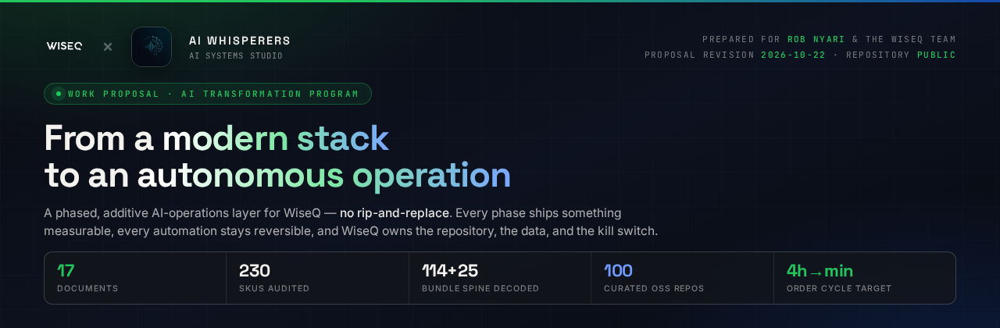
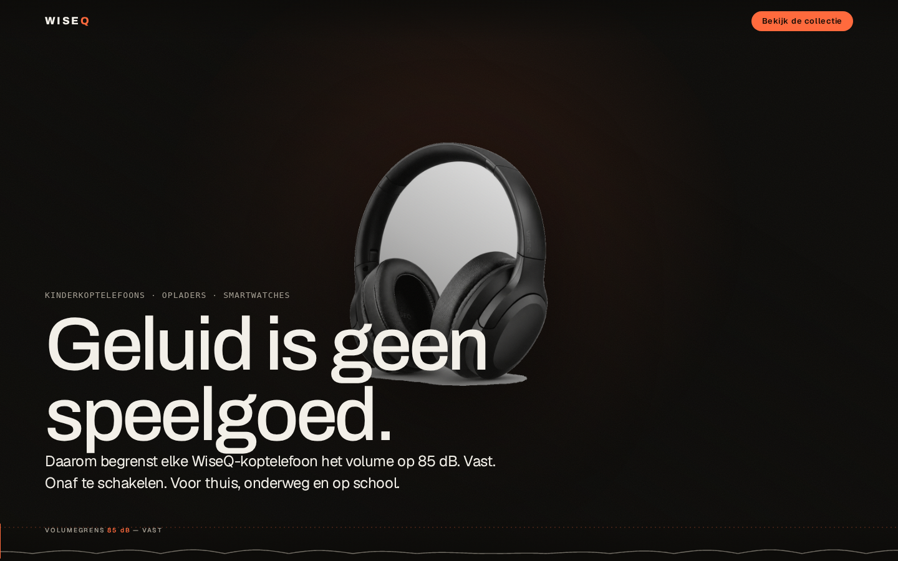
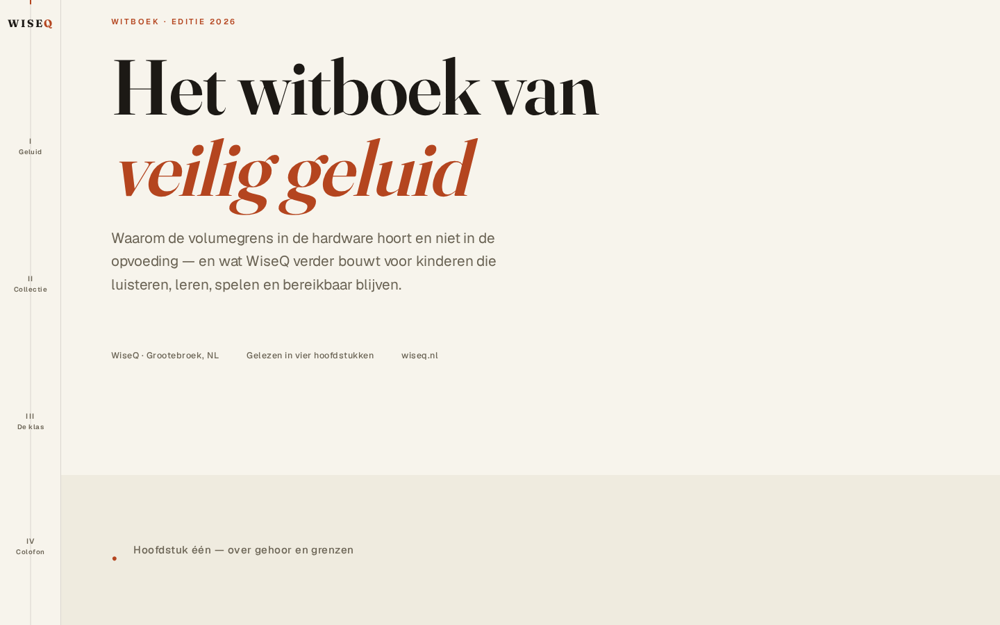
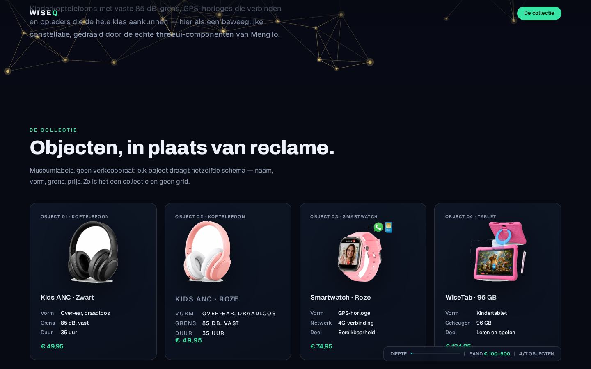

<div align="center">



</div>

<br>

<div align="center">

[](#document-map)
[](#the-case-in-one-page)
[](#the-case-in-one-page)
[](#track-c)
[](#evidence-base)
[](#evidence-base)
[](https://github.com/Ai-Whisperers/wiseq-ai-onboarding/actions/workflows/validate.yml)

[WiseQ](https://www.wiseq.nl) — the Dutch kids-technology brand from Grootebroek, Netherlands ·
prepared by [AI Whisperers](https://github.com/Ai-Whisperers)

</div>

---

<a id="if-you-are"></a>

## 👋 If you are…

| You are… | Read this first | Then |
| :--- | :--- | :--- |
| **Rob Nyari** — E-Commerce CEO, decision-maker | [The one-paragraph pitch](#the-one-paragraph-pitch) → [04 · AI Stack Blueprint](docs/04-AI-STACK-BLUEPRINT.md) | [06 · Next Steps](docs/06-NEXT-STEPS.md) for the four decisions we need from you |
| **A founder or director** deciding whether to commission this | [The case in one page](#the-case-in-one-page) → [Cost model](docs/04-AI-STACK-BLUEPRINT.md#cost-model-honest) | [09 · Competitors & Deals](docs/09-COMPETITORS-DEALS.md) for market pricing benchmarks |
| **An operations / purchase lead** | [05 · Automation Backlog](docs/05-AUTOMATION-BACKLOG.md) — every opportunity, ROI-scored | [07 · Reuse-First](docs/07-PY-TRANSFER-WISEQ.md) for the bundle-spine decode |
| **A technical evaluator or IT reviewer** | [04 · Architecture](docs/04-AI-STACK-BLUEPRINT.md) + [15 · Delivery Plan](docs/15-DEVOPS-MASTERPLAN.md) | [13 · Tooling & Integration Plan](docs/13-TOOLING-MCP-INSTALLS.md) for the concrete connector list |
| **New to this repository** | [Document map](#document-map) — 16 docs, four tracks | Everything else in this table is detail |

---

<a id="the-one-paragraph-pitch"></a>

## 🎯 The one-paragraph pitch

> WiseQ already runs a remarkably modern stack — **Shopify with a custom B2B layer, ChannelDock, 5X, and live agentic-commerce endpoints.** The gap isn't tools; it's **orchestration**. School orders eat four-hour mornings. Bundle stock is re-tracked by hand in Excel. Review volume is thin and marketing runs below the site's potential.
>
> We propose **one 24/7 AI-operations layer** — an orchestrated agent runtime that connects the mailbox, bookkeeping, ChannelDock, and the webshop — cutting the school-order process from **~4 hours to minutes**, making EAN-based purchasing automatic, and running reputation, content, and outreach continuously. **Most pieces already exist as connectable services.** Nothing is ripped out and replaced: every phase is additive and measurable.

---

<a id="the-case-in-one-page"></a>

## 📊 The case in one page

| The gap we found | The evidence | What we build | The measurable target |
| :--- | :--- | :--- | :--- |
| **School orders eat 4-hour mornings** | Founder-confirmed in working session | School-order pipeline: email → offer → invoice → ChannelDock booking | **4h → <15 min** human touch |
| **Bundle recombination pollutes purchase data** | A cable sells inside 4 adapter combinations; ChannelDock can't model it | Component↔bundle graph in a canonical EAN registry | Clean, true purchase data |
| **0 of 230 SKUs carry an EAN barcode** | Programmatic Shopify audit | EAN/GTIN backfill + GS1 registry — **€854/yr** for the 139 inventory-critical codes (114 components + 25 bundles), **€1,403/yr** for all 230 | 230/230 registered |
| **77 bundle-products (33%) have no component map** | Same audit — component→bundle mapping lives in human memory | Decoded **bundle spine**: 114 component SKUs + 25 bundles, 0 unresolved | Fully decomposed |
| **Purchase data assembled by hand in Excel** | 6-month rolling average per EAN, one costly error/year | Nightly purchase-intelligence job | Daily, automatic, correct |
| **25 reviews, no automated invitations** | Trustpilot 4.4/5 but only 25 reviews | Post-delivery review engine | Every order invited; TrustScore defended |
| **Scamadviser "Trust Score 0" flag** | Algorithmic remediation pending | Trust-profile remediation | Flag cleared |

---

<a id="document-map"></a>

## 🗺️ Document map

Twenty-two documents, four tracks. Each is self-contained and independently verifiable.

### Track A — The proposal *(what we recommend)*

| # | Doc | What's in it | Read if |
| :--- | :--- | :--- | :--- |
| **04** | [AI Stack Blueprint](docs/04-AI-STACK-BLUEPRINT.md) | **The main proposal** — architecture, phase-by-phase plan, honest cost model, guardrails | You want the sell. Start here. |
| **05** | [Automation Backlog](docs/05-AUTOMATION-BACKLOG.md) | 21 automations scored by impact and effort, 🔥 flags on do-first | You want the option list, ranked |
| **06** | [Next Steps](docs/06-NEXT-STEPS.md) | The ask-list, our Phase-0 commitments, **four decisions for WiseQ**, and the four hosting options | You need to unblock us this week |

### Track B — The company *(who WiseQ is)*

| # | Doc | What's in it |
| :--- | :--- | :--- |
| **01** | [Company Profile](docs/01-COMPANY-PROFILE.md) | Verified registry, timeline, channels, catalog, tech stack |
| **02** | [What We've Done](docs/02-WHAT-WE-DID.md) | Research dossier, market scan, lead-gen — with artifacts |
| **03** | [Meeting Notes 2026-10-21](docs/03-MEETING-NOTES-2026-10-21.md) | Business intel from our first working session |
| **07** | [Reuse-First](docs/07-PY-TRANSFER-WISEQ.md) | Existing capability mapped to WiseQ problems — incl. the decoded **bundle spine** |

<a id="track-c"></a>

### Track C — The market & regulation *(what surrounds the plan)*

| # | Doc | What's in it |
| :--- | :--- | :--- |
| **08** | [OSS & Integrations](docs/08-OSS-INTEGRATIONS.md) | Bol/Shopify/GS1/feed OSS landscape, EAN fix costs (€854/yr for 139 codes; €1,403/yr for all 230), NL trust marks, school collectives |
| **09** | [Competitors & Deals](docs/09-COMPETITORS-DEALS.md) | Real competitor map (iClever / Puro / Alpine / Heutink), deal pricing benchmarks, new opportunities |
| **10** | [OSS Catalog — 100 repos](docs/10-OSS-CATALOG-100.md) | 31 topics · 420 found · **100 curated** by stack layer, adopted additions (UVdesk, Umami, BillionMail, QuestPDF) |
| **11** | [Compliance & Regulatory](docs/11-COMPLIANCE-REGULATORY.md) | EN 71 / 62115 / RED (2025 cyber layer), GPSR, Thuiswinkel €983–1,759/yr, cert-evidence library plan |

### Track D — Deep analysis *(the stress tests)*

| # | Doc | What's in it |
| :--- | :--- | :--- |
| **12** | [Specialist Review — 31 Hats](docs/12-FIFTY-HATS.md) | 31 independent passes — product liability, bol account health, marketplace fees, VAT/EPR, accessibility, purchasing co-ops, school privacy, plus engineering and delivery review |
| **13** | [Tooling & Integration Plan](docs/13-TOOLING-MCP-INSTALLS.md) | Connector install list, three thin wrappers to build, week-by-week checklist |
| **15** | [Delivery Plan](docs/15-DEVOPS-MASTERPLAN.md) | CI/CD, storage & database architecture, SLOs, phased build checklist |
| **16** | [Delivery Review — How We Build](docs/16-DEV-TEAM-HATS.md) | **18 disciplines** — PM to Support Engineer; each states what it would flag, keep, and build first |
| **17** | [Site Concept Showcase](docs/17-SITE-CONCEPTS.md) | **Three built scroll-driven concepts** against WiseQ's real 229-product catalog — cinematic, editorial, and a WebGL constellation that visualises the bundle spine |
| **18** | [Working Together — Terms & Ownership](docs/18-TERMS-OWNERSHIP-CONTINUITY.md) | Who owns what, processor-vs-controller, GDPR Art. 28, continuity and exit — before signing, not in week three | You want the boring-but-decisive page |
| **19** | [Critical Review](docs/19-CRITICAL-REVIEW.md) | The adversarial pass on this proposal: what was wrong, what we fixed, what is still open | You want to see how this was stress-tested |
| **20** | [Send-to-Rob](docs/20-SEND-TO-ROB.md) | The copy-paste outreach message that turns the demos into a scheduled next step | You're about to send the link |
| **21** | [Who we are](docs/21-WHO-WE-ARE.md) | People page: names, roles, Dutch-capability evidence | ✅ |
| **22** | [Audit response](docs/22-AUDIT-RESPONSE.md) | Point-by-point response to the Oct-22 external audit | ✅ |

---

## ⚙️ Target architecture

```
┌───────────────────────────────────────────────────────────────────────┐
│  THE AI OPERATIONS LAYER — 24/7, reversible, audited                  │
│  orchestrator · memory · cron · kanban · skills · subagents          │
└───────────────────────────────────┬───────────────────────────────────┘
                                    │
        ┌───────────┬───────────┬───┴─────┬───────────┬───────────┐
        ▼           ▼           ▼         ▼           ▼           ▼
   ┌─────────┐ ┌─────────┐ ┌────────┐ ┌────────┐ ┌─────────┐ ┌────────┐
   │ Mailbox │ │ Book-   │ │Channel │ │ Shopify│ │ bol.com │ │ Web &  │
   │ IMAP/   │ │ keeping │ │ Dock   │ │ Admin  │ │ + 5X    │ │ market │
   │ SMTP    │ │ offers  │ │ stock &│ │ orders │ │ seller  │ │ intel  │
   │ (email) │ │ invoice │ │ pur-   │ │        │ │ APIs    │ │ scrape │
   └─────────┘ └─────────┘ │ chase  │ └────────┘ └─────────┘ └────────┘
                          └────────┘
```

Runs wherever you choose — **four hosting options**, from your own server maintained by us to shared capacity at a reduced rate. See [06 · Hosting options](docs/06-NEXT-STEPS.md#hosting-options). Credentials live in a vault — never in chat, never in this repo. Every automated action is logged to an audit trail, and **money-touching steps keep human approval** until trust is earned.

Full detail, phase by phase: **[04 · AI Stack Blueprint](docs/04-AI-STACK-BLUEPRINT.md)**

---

## 🗓️ Delivery phases

```
Phase 0 ────────────► Phase 1 ────────────► Phase 2 ────────────► Phase 3
Foundation            Kill the 4-hour      Revenue engines        Compounding
Week 1–2              mornings              Week 7–12              advantages
                                                                  Q2

Connect, read,        School-order          Reputation engine     Agentic-commerce
shadow. No writes.     pipeline · Bundle     B2B outreach          operations
Read-only dashboard   recombination         Content cadence        Supplier
+ EAN registry v1     Purchase reports      Marketplace relaunch   intelligence
+ shadow demo         Mailbox triage        ESP + cart flows      New segments
                                                                        EU expansion
```

**Every phase is additive.** Phase 0 writes nothing. Phase 1 adds one pipeline. If a phase underperforms, you stop and keep what works.

---

## 🛡️ Guardrails we commit to

| Guardrail | How it works |
| :--- | :--- |
| **Human approval gates** | Invoices, purchase orders, and outbound campaigns require approval for the first 90 days |
| **Full audit log** | Every agent action records who / what / when / why — their own `agents.md` philosophy, applied internally |
| **Secrets in a vault** | Never in chat, never in this repository |
| **GDPR discipline** | B2B role-address outreach under legitimate interest; named-person emails need lawful basis; unsubscribe in every send |
| **Kill switch** | Every automation is a cron job or webhook that can be paused in one command |
| **Reversible by design** | Nothing replaces an existing system; every phase can be rolled back |

---

## 🎨 Built, not described

*[Site Concept Showcase](docs/17-SITE-CONCEPTS.md)* — three scroll-driven site concepts we built against WiseQ's **real 229-product catalog**. Proof that this team ships working software, not slideware.

<table>
<tr>
<td width="33%"></td>
<td width="33%"></td>
<td width="33%"></td>
</tr>
<tr>
<td align="center"><sub><b>01 · Cinematic</b><br>Immersive dark hero<br><a href="https://ai-whisperers.github.io/wiseq-ai-onboarding/site-demos/v1-cinematic/index.html" target="_blank" rel="noopener">run it →</a></sub></td>
<td align="center"><sub><b>02 · Editorial</b><br>Print-inspired whitepaper<br><a href="https://ai-whisperers.github.io/wiseq-ai-onboarding/site-demos/v2-editorial/index.html" target="_blank" rel="noopener">run it →</a></sub></td>
<td align="center"><sub><b>03 · Constellation</b><br>WebGL · bundle spine made visible<br><a href="https://ai-whisperers.github.io/wiseq-ai-onboarding/site-demos/v3-webgl/index.html" target="_blank" rel="noopener">run it →</a></sub></td>
</tr>
</table>

> **Concept 03 is the commercially interesting one.** WiseQ's audit found 77 combinatorial bundle-products (33% of the catalog) whose component mapping lived only in human memory. That concept makes the bundle graph the *visual language* of the storefront — turning the operational weakness into a brand asset, and reusing the same component registry that would drive purchasing.

---

<a id="evidence-base"></a>

## 🔬 Evidence base

This proposal is not built on assumptions. Every claim traces to a verified artifact in this repository.

| Evidence track | Contents | Where |
| :--- | :--- | :--- |
| **Catalog & data-quality audit** | All 230 products, 1,277 images, 228 SKUs audited programmatically | [`data/research-lanes/RESEARCH_CATALOG.md`](data/research-lanes/RESEARCH_CATALOG.md) |
| **Company, registry & history** | Verified entity, domain history, timeline | [`data/research-lanes/RESEARCH_COMPANY.md`](data/research-lanes/RESEARCH_COMPANY.md) |
| **Marketplace & reputation** | bol.com, Amazon.nl, Trustpilot, Scamadviser — verified vs. not-found | [`data/research-lanes/RESEARCH_MARKETPLACES.md`](data/research-lanes/RESEARCH_MARKETPLACES.md) |
| **Marketing, SEO & competition** | 45-page knowledge hub, 12 blog articles, agentic-readiness | [`data/research-lanes/RESEARCH_MARKETING_COMPETITION.md`](data/research-lanes/RESEARCH_MARKETING_COMPETITION.md) |
| **Consolidated dossier** | The one-page cross-cutting synthesis | [`data/research-lanes/WISEQ-DOSSIER.md`](data/research-lanes/WISEQ-DOSSIER.md) |
| **B2B lead-gen (NL)** | 8,673 organizations mapped · 857 with verified emails · methodology and counts only | [`data/leadgen-summary.md`](data/leadgen-summary.md) |
| **Bundle spine** | 114 component SKUs + 25 bundles, referentially validated | [`data/wiseq-bundle-spine.csv`](data/wiseq-bundle-spine.csv) · [`data/wiseq-component-registry.csv`](data/wiseq-component-registry.csv) |
| **OSS catalog** | 31 topics · 420 repos found · 100 curated by stack layer | [`docs/10-OSS-CATALOG-100.md`](docs/10-OSS-CATALOG-100.md) · raw JSON in [`data/oss/`](data/oss/) |

> 🔒 **Data note — by design, this repository contains no personal contact data.** Our lead-generation research produced large B2B contact datasets (school boards, special-education networks, EU education registers). Those stay private and are handed over directly under GDPR-compliant terms. See [`data/leadgen-summary.md`](data/leadgen-summary.md) for counts, sources, and methodology only.

---

## 📦 What else is in this repository

```
wiseq-ai-onboarding/
├── docs/                    16 proposal, analysis & showcase documents
│   ├── 01-COMPANY-PROFILE.md … 17-SITE-CONCEPTS.md
├── data/
│   ├── oss/                 31 raw GitHub-search JSON files (query + results)
│   ├── research-lanes/      5 original research reports + raw agents.md capture
│   ├── wiseq-bundle-spine.csv
│   ├── wiseq-component-registry.csv
│   └── leadgen-summary.md
├── assets/
│   ├── brand/                Logo variants, hero banner, OG card
│   └── demos/                Screenshots of the 3 site concepts
├── site-demos/              3 scroll-driven site concepts + product imagery
├── scripts/validate_repo.py Repo-integrity CI (doc links, data schema, spine, secrets)
└── .github/workflows/       validate · gitleaks · zizmor
```

**CI runs on every push** and enforces: every `docs/` link in this README resolves · every `data/oss/*.json` parses and carries the required schema · every bundle component resolves to the registry · no secret patterns anywhere. Reproduce locally with:

```bash
python3 scripts/validate_repo.py
```

---

## 📌 Status

- **2026-10-21** — repo created. Research phase complete (company, catalog, marketplaces, marketing, EU market, B2B lead-gen). Awaiting WiseQ's company manual + stack inventory to start Phase 0.
- **2026-10-22** — **bundle spine decoded** from public catalog data — 114 component SKUs + 25 composite bundles fully decomposed (0 unresolved). Reuse-first mapping added (docs/07).
- **2026-10-22** — tooling & integration plan — connector install list, three thin wrappers queued, week-by-week checklist.
- **2026-10-22** — specialist review — 30 independent passes across compliance, risk, engineering and delivery; 12 actions graduate to the build plan.
- **2026-10-22** — compliance map — EN 71 / 62115 / RED (incl. Aug-2025 cybersecurity act), GPSR responsible-person check, Thuiswinkel costs verified.
- **2026-10-22** — OSS catalog expanded to 31 topics / 100 curated repos by layer.
- **2026-10-22** — competitors & deals research — competitor map, deal pricing benchmarks, 6 new opportunities.
- **2026-10-22** — OSS & integrations research — the NL e-com tooling layer is thin (orchestration IS the moat); GS1 EAN fix quantified (€854/yr recurring for 139 codes, not one-off).

**Waiting on WiseQ:** the ~30-page company manual, software inventory, sandbox dataset, and read-only access. Full ask-list: **[06 · Next Steps](docs/06-NEXT-STEPS.md)**

---

## 💬 Response channel

This repository is the collaboration surface. **Open an issue or comment on any document** — we monitor it and respond there. Questions, corrections, and "we already solved this differently" are all welcome; the goal is a plan that fits your reality, not ours.

---

## 📎 Provenance

| | |
| :--- | :--- |
| **Prepared by** | [AI Whisperers](https://github.com/Ai-Whisperers) — AI systems & automation studio |
| **Prepared for** | Rob Nyari & the WiseQ team · [wiseq.nl](https://www.wiseq.nl) |
| **Revision** | 2026-10-22 |
| **Working session** | 2026-10-21 · Grootebroek, NL ([notes](docs/03-MEETING-NOTES-2026-10-21.md)) |
| **License** | See repository · client-proposal material, citation with attribution welcome |

---

<div align="center">
<sub>Built as a public proof-of-work proposal — every claim here is independently verifiable in minutes.</sub>
</div>